# @ruvnet/bmssp

[](https://www.npmjs.com/package/@ruvnet/bmssp)
[](https://github.com/ruvnet/bmssp/actions/workflows/ci.yml)
[](LICENSE)

Single-source shortest paths, written in Rust and compiled to WebAssembly. It runs in Node.js 18+ and in browsers, and ships TypeScript types.



## Which package to use

Use **`@ruvnet/bmssp`**. It is the canonical package.

`bmssp-wasm` is a duplicate. Version 1.0.0 of both packages was published from the same build, with the same wasm binary. `bmssp-wasm` gets no further releases and is being deprecated in favor of `@ruvnet/bmssp`.

## Install

```bash
npm install @ruvnet/bmssp
```

## Quickstart

```js
import init, { WasmGraph } from '@ruvnet/bmssp';

await init();

// 4 vertices, directed edges with weights
const graph = new WasmGraph(4, true);
graph.add_edge(0, 1, 1.0);
graph.add_edge(1, 2, 2.5);
graph.add_edge(0, 2, 5.0);
graph.add_edge(2, 3, 1.0);

const distances = graph.compute_shortest_paths(0); // Float64Array
console.log(Array.from(distances)); // [ 0, 1, 3.5, 4.5 ]
console.log(graph.vertex_count, graph.edge_count); // 4 4

graph.free();
```

Save it as `quickstart.mjs` and run `node quickstart.mjs`. The same file is in [`npm/examples/quickstart.mjs`](npm/examples/quickstart.mjs), and CI runs it against a fresh install of the packed tarball.

`init()` loads the wasm module. You must call it once before you construct a graph. Further calls do nothing.
- In Node, `init()` with no argument reads `bmssp_rust_bg.wasm` from the package directory.
- In a browser or bundler, it fetches the file next to `bmssp_rust.js`. To load the module from somewhere else, pass `{ module_or_path }` (a URL, a `Response`, bytes, or a `WebAssembly.Module`).
- `initSync({ module })` takes bytes or a compiled module and initializes synchronously.

## API

### `WasmGraph`

| Member | Description |
|---|---|
| `new WasmGraph(vertices: number, directed: boolean)` | Creates an empty graph with vertices `0 .. vertices-1`. |
| `add_edge(from, to, weight): boolean` | Adds a weighted edge. Returns `false` if a vertex index is out of range. In an undirected graph, this adds both directions. |
| `compute_shortest_paths(source): Float64Array` | Returns the distance from `source` to every vertex, computed with Bellman-Ford (early exit when no distance improves). A vertex that cannot be reached gets `Infinity`. Negative weights are allowed. If the source is out of range or the graph has a negative cycle, every entry is `Infinity`. |
| `vertex_count` / `edge_count` | Read-only counts. In an undirected graph, `edge_count` counts each edge twice, once per direction. |
| `free()` | Releases the wasm memory. |

### `WasmNeuralBMSSP`

This variant combines edge weights with distances between node embeddings.

| Member | Description |
|---|---|
| `new WasmNeuralBMSSP(vertices, embedding_dim)` | Creates a graph whose nodes all start with zero embeddings. |
| `set_embedding(node, embedding: Float64Array): boolean` | Sets one node's embedding. |
| `add_semantic_edge(from, to, alpha)` | Adds an edge whose weight is `alpha` times the Euclidean distance between the two endpoints' embeddings, measured when the edge is added. |
| `compute_neural_paths(source): Float64Array` | Returns distances from `source` over the semantic edges. |
| `semantic_distance(a, b): number` | Returns the Euclidean distance between two nodes' embeddings. |
| `update_embeddings(gradients_flat, learning_rate, embedding_dim): boolean` | Applies a gradient step to every embedding. |
| `free()` | Releases the wasm memory. |

## Changes in 1.0.1

- The README in 1.0.0 documented an API that did not exist (`BmsSpGraph`, `shortest_path`, `dist/bmssp.js`). This README documents the real exports.
- In 1.0.0, calling `init()` with no argument failed under Node with `fetch failed`. Node now gets its own entry point, which reads the wasm from disk.
- The `exports` map now exposes `./bmssp_rust_bg.wasm` and `./package.json`.
- The wasm is rebuilt from the Rust source in this repository (wasm-bindgen 0.2.100, same TypeScript surface as 1.0.0). Unmaintained optional dependencies (`wee_alloc`, `pprof`) were removed, and `cargo audit` is clean.
- Requires Node 18 or later.

## Build from source

The Rust crate in this repository is the source of the npm package.

```bash
cargo test
./scripts/build-npm.sh          # wasm-pack build --target web, stages files into npm/
cd npm && npm pack
```

## License

MIT. See [LICENSE](LICENSE).

Links: [ruv.io](https://ruv.io) · [Issues](https://github.com/ruvnet/bmssp/issues)
